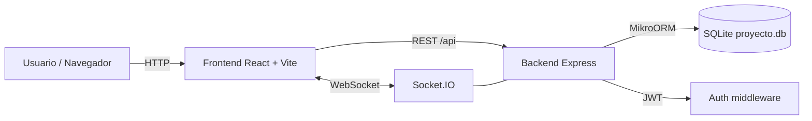
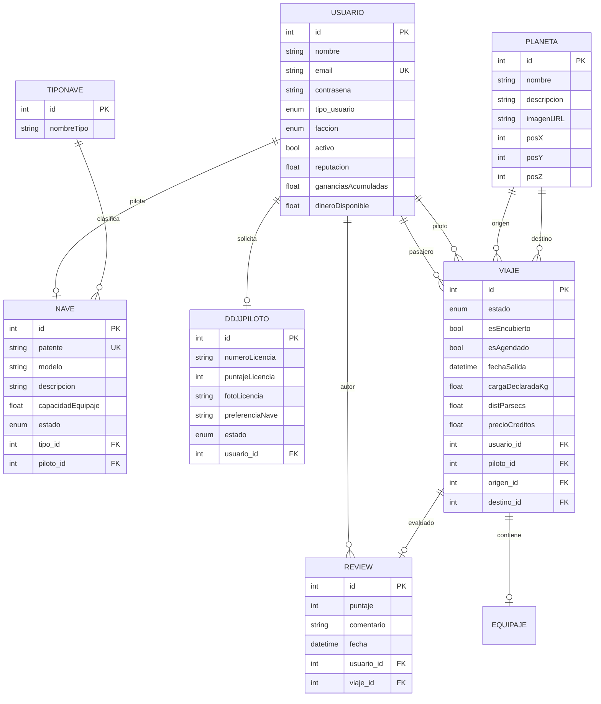
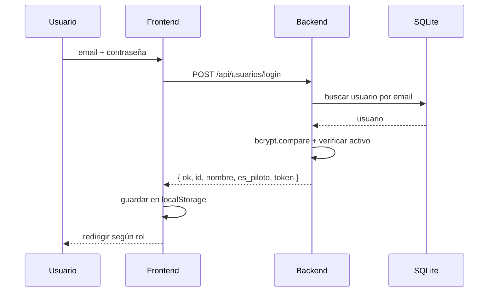
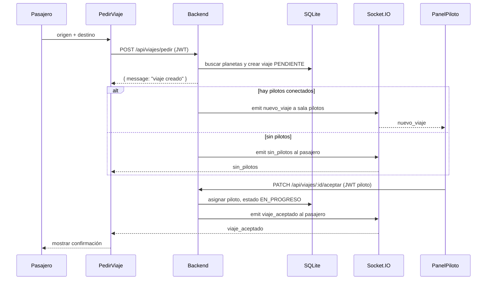

# Análisis del Sistema — FlySolo

**Proyecto:** FlySolo  
**Arquitectura:** Monorepo fullstack (backend API REST + frontend SPA)  
**Stack:** Node.js · TypeScript · Express · MikroORM · SQLite · Socket.IO · React · Vite  
**Documento:** Análisis técnico del sistema  
**Versión:** 1.0

---

## 1. Resumen

FlySolo está implementado como un monorepo con dos paquetes:

- `backend`: API REST con Express 5, TypeScript, MikroORM sobre SQLite y Socket.IO.
- `frontend`: SPA con React 19, React Router 7 y Vite.

El backend expone endpoints bajo `/api`, autentica con JWT, persiste en `backend/proyecto.db` y emite eventos en tiempo real para el flujo de viajes. El frontend consume la API mediante `fetch`, protege rutas por rol y se conecta por Socket.IO para recibir confirmaciones.

---

## 2. Arquitectura general



### Características de la arquitectura
- **Cliente-servidor** con API REST.
- **Monorepo** gestionado con pnpm workspaces.
- **Autenticación stateless** mediante JWT.
- **Comunicación en tiempo real** con Socket.IO.
- **Persistencia local** con SQLite y sincronización de esquema automática.
- **Separación por módulos** de dominio (usuario, planeta, viaje, nave, etc.).

---

## 3. Stack tecnológico

### Backend
| Tecnología | Uso |
|---|---|
| Node.js + TypeScript | Runtime y tipado |
| Express 5 | Servidor HTTP y ruteo |
| MikroORM 6 + `@mikro-orm/sqlite` | ORM y persistencia |
| SQLite | Base de datos local |
| `bcryptjs` | Hash de contraseñas |
| `jsonwebtoken` | Emisión y verificación de JWT |
| `socket.io` | Eventos en tiempo real |
| `cors`, `dotenv` | Configuración |
| `tsc-watch` | Desarrollo con recompilación |

### Frontend
| Tecnología | Uso |
|---|---|
| React 19 | UI |
| React Router 7 | Ruteo SPA |
| Vite 8 | Build y dev server |
| TypeScript | Tipado |
| `socket.io-client` | Eventos en tiempo real |
| CSS propio (`index.css`, `App.css`) | Estilos |

> Nota: `axios`, `tailwindcss` y `helmet` figuran como dependencias, pero en el código actual se usa `fetch`, CSS propio y no se aplica `helmet`.

---

## 4. Estructura del repositorio

```
FlySolo_DSW/
├── package.json                 # scripts raíz (dev, backend, frontend)
├── pnpm-workspace.yaml          # workspaces: backend, frontend
├── pnpm-lock.yaml
├── backend/
│   ├── .env                     # configuración (ignorado por git)
│   ├── proyecto.db              # base SQLite
│   ├── package.json
│   ├── tsconfig.json
│   └── src/
│       ├── app.ts               # bootstrap Express + Socket.IO
│       ├── seed.ts              # datos iniciales
│       ├── config/
│       ├── shared/
│       │   ├── db/              # orm.ts, baseEntity.entity.ts
│       │   ├── enums/           # domain.enums.ts
│       │   ├── middleware/      # auth.middleware.ts
│       │   └── realtime.ts      # helpers de Socket.IO
│       ├── usuario/
│       ├── planeta/
│       ├── viaje/
│       ├── nave/
│       ├── tipoNave/
│       ├── review/
│       ├── ddjjPiloto/
│       └── equipaje/
└── frontend/
    ├── .env                     # VITE_API_URL, VITE_SOCKET_URL
    ├── package.json
    ├── vite.config.ts
    └── src/
        ├── main.tsx
        ├── App.tsx
        ├── auth.ts
        ├── config.ts
        ├── socket.ts
        ├── types.ts
        ├── Home.tsx
        ├── PanelPiloto.tsx
        ├── MostrarNaves.tsx
        ├── listarUsuarios.tsx
        ├── components/NavBar.tsx
        └── pages/
            ├── Login.tsx
            ├── Register.tsx
            ├── usuario/PedirViaje.tsx
            ├── usuario/MisViajesPage.tsx
            ├── administrador/AdminPanel.tsx
            ├── planetas/PlanetasPage.tsx
            ├── naves/NavesPage.tsx
            ├── viajes/ViajesPage.tsx
            └── resenas/ResenasPage.tsx
```

---

## 5. Modelo de datos



### Entidades principales
| Entidad | Archivo | Responsabilidad |
|---|---|---|
| `Usuario` | `backend/src/usuario/usuario.entity.ts` | Cuenta, rol, facción, saldo y relaciones |
| `Planeta` | `backend/src/planeta/planeta.entity.ts` | Catálogo de destinos y coordenadas |
| `Nave` | `backend/src/nave/nave.entity.ts` | Naves y piloto asignado |
| `TipoNave` | `backend/src/tipoNave/tipoNave.entity.ts` | Clasificación de naves |
| `Viaje` | `backend/src/viaje/viaje.entity.ts` | Solicitud y estado del viaje |
| `Review` | `backend/src/review/review.entity.ts` | Reseñas de viajes |
| `DDJJPiloto` | `backend/src/ddjjPiloto/ddjjPiloto.entity.ts` | Solicitud de habilitación de piloto |
| `Equipaje` | `backend/src/equipaje/equipaje.embeddable.ts` | Objeto embebido en el viaje |

### Enums de dominio
Definidos en `backend/src/shared/enums/domain.enums.ts`:
- `TipoUsuario`: `ADMIN`, `PILOTO`, `PASAJERO`
- `Faccion`: `REBELDE`, `IMPERIAL`, `NEUTRAL`
- `EstadoNave`: `LIBRE`, `ASIGNADA`
- `EstadoSolicitud`: `PENDIENTE`, `APROBADA`, `RECHAZADA`
- `EstadoViaje`: `PENDIENTE`, `EN_PROGRESO`, `FINALIZADO`, `CANCELADO`

### Persistencia
- ORM: MikroORM con `SqliteDriver`.
- Archivo: `./proyecto.db` (relativo al directorio del backend).
- Esquema: se sincroniza automáticamente al iniciar (`SyncSchema()` / `updateSchema()`).
- No se usan migraciones versionadas en la operación actual.
- Claves primarias numéricas autoincrementales (`BaseEntity.id`).

---

## 6. Backend

### 6.1 Bootstrap (`backend/src/app.ts`)
1. Carga `dotenv`.
2. Configura CORS para `localhost:5173`, `127.0.0.1:5173`, `localhost:4173` y `127.0.0.1:4173`.
3. Habilita JSON.
4. Crea un contexto de MikroORM por request (`RequestContext.create`).
5. Monta los routers.
6. Sincroniza el esquema.
7. Crea el servidor HTTP y Socket.IO.
8. Escucha en `PORT` (por defecto 3000).

### 6.2 API REST

Base: `http://localhost:3000/api`

#### Usuarios (`/api/usuarios`)
| Método | Ruta | Auth | Descripción |
|---|---|---|---|
| POST | `/login` | Público | Login, devuelve `{ ok, id, nombre, es_piloto, token }` |
| POST | `/register` | Público | Registro con `tipo_usuario` (`PASAJERO`/`PILOTO`) y `faccion`. Si es piloto, recibe `nave` y deja el registro pendiente |
| GET | `/verUsuarios` | Público | Lista usuarios (sin contraseña) |
| GET | `/verUsuario/:id` | Público | Detalle de usuario |
| GET | `/rol/pilotos` | Admin | Lista pilotos |
| GET | `/rol/pasajeros` | Admin | Lista pasajeros |
| GET | `/pendientes` | Admin | Lista pilotos con registro pendiente y su nave |
| PATCH | `/:id/aprobar` | Admin | Aprueba un piloto pendiente (activo y sin pendiente) |
| PATCH | `/:id/rechazar` | Admin | Rechaza y elimina la cuenta del piloto y su nave |
| PATCH | `/:id/baja` | Admin | Da de baja |
| PATCH | `/:id/reactivar` | Admin | Reactiva |
| POST | `/create` | Admin | Alta administrativa |
| PUT/PATCH | `/update/:id` | Admin | Modificación |
| DELETE | `/delete/:id` | Admin | Baja definitiva |

#### Planetas (`/api/planetas`)
| Método | Ruta | Auth | Descripción |
|---|---|---|---|
| GET | `/` y `/verPlanetas` | Público | Lista; filtros `?nombre=`, `?descripcion=` y `?q=` |
| GET | `/verPlaneta/:id` | Público | Detalle |
| POST | `/create` | Admin | Alta |
| PUT/PATCH | `/update/:id` | Admin | Modificación |
| DELETE | `/delete/:id` | Admin | Baja |
| POST | `/cotizarViaje` | Público | Cotiza por nombre de origen/destino |

#### Viajes (`/api/viajes`)
| Método | Ruta | Auth | Descripción |
|---|---|---|---|
| POST | `/pedir` | Usuario | Crea viaje pendiente |
| GET | `/pendientes` | Piloto | Lista viajes pendientes |
| GET | `/mios` | Usuario | Viajes del pasajero/piloto autenticado |
| PATCH | `/:id/aceptar` | Piloto | Asigna piloto y pasa a `EN_PROGRESO` |
| PATCH | `/:id/finalizar` | Dueño/Piloto asignado/Admin | Pasa a `FINALIZADO` y suma ganancias al piloto |
| PATCH | `/:id/cancelar` | Dueño/Piloto/Admin | Pasa a `CANCELADO` |
| GET | `/verViajes` | Público | Lista viajes; filtros `?estado=`, `?usuarioId=`, `?pilotoId=` |
| GET | `/verViaje/:id` | Público | Detalle con usuario, piloto, planetas y review |
| POST | `/create` | Admin | Alta directa |
| PUT/PATCH | `/update/:id` | Admin | Modificación |
| DELETE | `/delete/:id` | Admin | Baja |

#### Naves (`/api/naves`)
| Método | Ruta | Auth | Descripción |
|---|---|---|---|
| GET | `/verNaves` | Admin | Lista completa de la flota (filtro `?modelo=`), exclusiva del administrador |
| GET | `/mia` | Piloto | Devuelve únicamente la nave asignada al piloto autenticado |
| GET | `/verNave/:id` | Admin o piloto dueño | Detalle de una nave; el piloto solo puede ver la suya |
| POST | `/create` | Admin | Alta |
| PUT/PATCH | `/update/:id` | Admin | Modificación |
| DELETE | `/delete/:id` | Admin | Baja |

#### Tipos de nave (`/api/tiposnave`)
`GET /verTipoNaves`, `GET /verTipoNave/:id`, `POST /create` (admin), `PUT|PATCH /update/:id` (admin), `DELETE /delete/:id` (admin).

#### Reviews (`/api/reviews`)
`GET /` y `GET /:id` son exclusivos del rol piloto y devuelven únicamente las reseñas recibidas por el piloto autenticado (filtros `?viajeId=`, `?puntaje=`). `POST /` requiere JWT y que el usuario sea el pasajero dueño de un viaje `FINALIZADO`; `PUT|PATCH /:id` y `DELETE /:id` requieren ser autor de la reseña o administrador. La reputación del piloto se recalcula al crear, editar o eliminar.

#### DDJJ de pilotos (`/api/ddjj`)
`GET /verDDJJ`, `GET /verDDJJ/:id`, `POST /create` (auth), `PUT|PATCH /update/:id` (auth), `DELETE /delete/:id` (auth).

### 6.3 Autenticación y autorización

- **Hash:** `bcryptjs` con costo 10.
- **Token:** JWT firmado con `JWT_SECRET`; expiración `JWT_EXPIRES_IN` (7 días por defecto).
- **Payload:** `{ id, es_piloto }`, donde `es_piloto` es `2` admin, `1` piloto, `0` pasajero.
- **Header:** `Authorization: Bearer <token>`.
- **Middlewares** (`shared/middleware/auth.middleware.ts`):
  - `verificarToken`: valida JWT y carga `req.usuario`.
  - `soloAdmin`: exige rol 2.
  - `soloPiloto`: exige rol 1.
- La contraseña está marcada como `hidden` en la entidad, por lo que no se serializa en las respuestas.

### 6.4 Tiempo real (Socket.IO)

- Servidor creado en `app.ts`; helpers en `shared/realtime.ts`.
- Al conectarse, el cliente envía `id` y `es_piloto` por query:
  - Pilotos → sala `pilotos`.
  - Resto → sala `usuario_<id>`.

**Eventos emitidos por el backend**
| Evento | Destino | Cuándo |
|---|---|---|
| `nuevo_viaje` | Sala `pilotos` | Se crea un viaje y hay pilotos conectados |
| `sin_pilotos` | Sala `usuario_<id>` | Se crea un viaje y no hay pilotos conectados |
| `viaje_aceptado` | Sala `usuario_<id>` | Un piloto acepta el viaje |
| `viaje_finalizado` | Sala `usuario_<id>` | El pasajero o un admin finaliza el viaje |

**Eventos escuchados por el frontend**
| Evento | Pantalla |
|---|---|
| `nuevo_viaje` | `PanelPiloto.tsx` |
| `viaje_aceptado` | `PedirViaje.tsx` |
| `sin_pilotos` | `PedirViaje.tsx` |

### 6.5 Configuración

`backend/.env` (ignorado por git):
```env
PORT=3000
JWT_SECRET=flysolo_super_secret_cambiar_en_produccion
JWT_EXPIRES_IN=7d
FRONTEND_URL=http://localhost:5173
NODE_ENV=development
```

`frontend/.env` (ignorado por git):
```env
VITE_API_URL=http://localhost:3000/api
VITE_SOCKET_URL=http://localhost:3000
```

---

## 7. Frontend

### 7.1 Rutas

Definidas en `frontend/src/App.tsx`:

| Ruta | Componente | Protección |
|---|---|---|
| `/` | `Home` | Pública |
| `/login` | `Login` | Pública |
| `/register` | `Register` | Pública |
| `/listarUsuarios` | `ListarUsuarios` | Pública |
| `/planetas` | `PlanetasPage` | Pública (ABM solo admin) |
| `/naves` | `NavesPage` | Pública (ABM solo admin) |
| `/viajes` | `ViajesPage` | Pública (ABM solo admin) |
| `/resenas` | `ResenasPage` | Pública (edición según autor/admin) |
| `/pedir` | `PedirViaje` | Rol 0 (pasajero) |
| `/mis-viajes` | `MisViajesPage` | Rol 0 (pasajero) |
| `/piloto` | `PanelPiloto` | Rol 1 (piloto) |
| `/admin` | `AdminPanel` | Rol 2 (admin) |
| `*` | Redirección a `/` | — |

`RutaProtegida` valida token y rol desde `localStorage`; si el rol no coincide, redirige al panel correspondiente.

### 7.2 Componentes principales
| Componente | Archivo | Función |
|---|---|---|
| `Home` | `Home.tsx` | Pantalla de bienvenida |
| `Login` | `pages/Login.tsx` | Autenticación y guardado de sesión |
| `Register` | `pages/Register.tsx` | Registro de pasajero |
| `PedirViaje` | `pages/usuario/PedirViaje.tsx` | Solicitud de viaje y confirmación |
| `PanelPiloto` | `PanelPiloto.tsx` | Lista y aceptación de viajes |
| `AdminPanel` | `pages/administrador/AdminPanel.tsx` | Gestión de usuarios y tipos de nave |
| `PlanetasPage` | `pages/planetas/PlanetasPage.tsx` | Listado filtrado por descripción, detalle y ABM |
| `NavesPage` | `pages/naves/NavesPage.tsx` | Listado filtrado por modelo, detalle y ABM |
| `ViajesPage` | `pages/viajes/ViajesPage.tsx` | Listado filtrado por estado, detalle, ABM y cambios de estado |
| `ResenasPage` | `pages/resenas/ResenasPage.tsx` | Listado filtrado, detalle, edición y eliminación de reseñas |
| `MisViajesPage` | `pages/usuario/MisViajesPage.tsx` | Viajes del pasajero, finalización y calificación |
| `NavBar` | `components/NavBar.tsx` | Navegación y sesión |
| `ListarUsuarios` | `listarUsuarios.tsx` | Listado público de usuarios |
| `MostrarNaves` | `MostrarNaves.tsx` | Listado de naves (no ruteado) |

### 7.3 Estado y sesión
- Sesión en `localStorage`: `id`, `nombre`, `es_piloto`, `token`.
- Helpers en `frontend/src/auth.ts`: `getToken`, `getRol`, `authHeaders`, `logout`, etc.
- Socket en `frontend/src/socket.ts` con `connectSocket()` que toma los datos de `localStorage`.

### 7.4 Manejo de datos
- Peticiones con `fetch` y `authHeaders()`.
- Respuestas del backend con formato `{ message, data }` o `{ ok, ... }` según endpoint.
- Estilos con CSS propio; no se usa Tailwind pese a estar instalado.

---

## 8. Flujos principales

### 8.1 Login



### 8.2 Pedido y aceptación de viaje



### 8.3 Cálculo de precio
Implementado en `pedirViaje` y `cotizarViaje`:
```ts
distancia = Math.sqrt(dx*dx + dy*dy + dz*dz);
precio = Math.round(distancia * 100);
```
La distancia se guarda en `distParsecs` y el precio en `precioCreditos`.

---

## 9. Seguridad

### Implementado
- Hash de contraseñas con bcrypt.
- JWT con expiración.
- Autorización por rol en endpoints administrativos y de piloto.
- CRUD de Planetas, Naves, Tipos de Nave, Viajes y Usuarios protegidos con JWT + `soloAdmin`.
- Flota completa (`/naves/verNaves`) exclusiva del administrador; el piloto accede solo a su nave (`/naves/mia`).
- Registro de pilotos pendiente de aprobación (`registroPendiente`) y login bloqueado hasta que un administrador lo apruebe.
- Endpoints de aprobación/rechazo de pilotos protegidos con JWT + `soloAdmin`; el rechazo elimina la nave y la cuenta.
- Reviews de lectura protegidas con JWT + `soloPiloto`, filtradas por el piloto autenticado; escritura limitada al pasajero dueño del viaje finalizado y edición/borrado al autor o administrador.
- Finalización/cancelación restringidas al dueño, piloto asignado o administrador según la acción.
- Contraseña oculta en serialización.
- CORS restringido a orígenes locales (`localhost` y `127.0.0.1`).
- El pasajero se toma del token en `pedirViaje` (no del body).

### Mejoras recomendadas
- Validación y sanitización de entrada más estricta con esquemas.
- Rate limiting y protección contra fuerza bruta.
- Uso de `helmet`.
- Cookies `httpOnly` o almacenamiento más seguro que `localStorage` para el token.
- Rotación de secretos y configuración por entorno.
- Validar que el piloto tenga nave/DDJJ aprobada antes de aceptar viajes.
- Liberar automáticamente la nave/piloto al finalizar o cancelar un viaje.

---

## 10. Persistencia y datos iniciales

### Seed (`backend/src/seed.ts`)
Crea, si no existe el admin:
- 1 administrador, 2 pilotos y 1 pasajero (contraseñas hasheadas).
- 2 tipos de nave y 2 naves.
- 5 planetas con coordenadas.

**Credenciales de prueba**
| Usuario | Email | Contraseña | Rol |
|---|---|---|---|
| Admin | `admin@flysolo.com` | `admin123` | 2 |
| Piloto | `piloto1@flysolo.com` | `piloto123` | 1 |
| Piloto | `piloto2@flysolo.com` | `piloto123` | 1 |
| Pasajero | `pasajero@flysolo.com` | `pasajero123` | 0 |

### Sincronización de esquema
Al iniciar, `SyncSchema()` ejecuta `updateSchema()`, por lo que la base se adapta a las entidades sin migraciones manuales. Es cómodo para desarrollo, pero riesgoso para producción.

---

## 11. Configuración y ejecución

### Requisitos
- Node.js (probado con v26)
- pnpm 10

### Instalación
```bash
pnpm install
```

### Datos iniciales
```bash
pnpm --filter backend seed
```

### Desarrollo
```bash
pnpm dev            # backend + frontend en paralelo
pnpm backend        # solo backend
pnpm frontend       # solo frontend
```

### Build
```bash
pnpm --filter backend build
pnpm --filter frontend build
```

### URLs
- Frontend: `http://localhost:5173`
- Backend: `http://localhost:3000`
- API: `http://localhost:3000/api`

---

## 12. Verificación y calidad

### Verificado
- Compilación del backend (`tsc`) sin errores.
- Build del frontend (`tsc -b && vite build`) sin errores.
- Lint del frontend sin errores.
- Login/registro y validaciones (401, 403, 409).
- Baja/reactivación de usuarios.
- CRUD de usuarios, planetas, naves y tipos de nave desde la UI.
- Filtros de planetas por descripción y de viajes por estado, con detalle al seleccionar.
- Filtros de naves por modelo y de reseñas por piloto/comentario, con detalle.
- Pedido, listado, aceptación, finalización y cancelación de viajes.
- Flujo Socket.IO completo: `nuevo_viaje` → aceptar → `viaje_aceptado`.
- Flujo de reseña: solo viajes finalizados, una por viaje, con recálculo de reputación y ganancias.
- Edición y eliminación de reseñas por autor/admin.
- Seed limpio y reproducible.

### Cobertura ausente
- No hay tests automatizados (unitarios, integración ni E2E).
- No hay pipeline CI/CD.
- No hay monitoreo ni logs estructurados.

---

## 13. Limitaciones y deuda técnica

| Área | Observación |
|---|---|
| Validación | Falta validación de esquemas y mensajes de error uniformes |
| Autorización | Las lecturas de catálogo son públicas por diseño; falta rate limiting |
| Estado del viaje | No se libera automáticamente la nave/piloto al finalizar o cancelar |
| Reviews | Implementado con edición/eliminación por autor o admin |
| DDJJ | Backend listo, frontend sin pantalla |
| Naves | No se valida disponibilidad ni asignación al aceptar |
| Persistencia | SQLite local; sin migraciones versionadas |
| Archivos | `proyecto.db` versionado en el repo |
| Dependencias | `axios`, `tailwindcss`, `helmet` instalados pero sin uso |
| Frontend | Componentes antiguos sin ruta (`Pedir.tsx`, `MostrarNaves.tsx`) |
| Sesión | Token en `localStorage` |
| Testing | Sin pruebas automatizadas |
| Observabilidad | Sin logs estructurados ni métricas |

---

## 14. Recomendaciones

### Corto plazo
1. Completar la pantalla de DDJJ de pilotos.
2. Liberar nave/piloto al finalizar o cancelar viajes.
3. Implementar validaciones de entrada y manejo global de errores.
4. Agregar tests automatizados del flujo de viajes y reseñas.
5. Eliminar o integrar componentes sin ruta.

### Mediano plazo
1. Incorporar tests automatizados y CI.
2. Migrar a PostgreSQL y usar migraciones versionadas.
3. Aplicar `helmet`, rate limiting y una estrategia de sesión más segura.
4. Separar configuración por entornos y remover secretos por defecto.
5. Agregar logs estructurados y métricas.

### Largo plazo
1. Escalar el backend (réplicas, colas, cache).
2. Implementar matching y precios dinámicos.
3. Incorporar observabilidad y alertas.
4. Preparar despliegue productivo con HTTPS y backups.

---

## 15. Conclusión

El sistema está bien estructurado para un proyecto académico/fullstack: separación clara de módulos, modelo de dominio coherente, autenticación con roles, API REST y comunicación en tiempo real. El flujo principal de negocio funciona de punta a punta y fue verificado.

Las principales brechas están en robustez (validación, autorización completa, tests), en completar la experiencia de usuario (reseñas, DDJJ, cierre de viajes) y en preparar la persistencia y el despliegue para un contexto productivo. Con estas mejoras, la base actual puede evolucionar sin reescrituras mayores.
