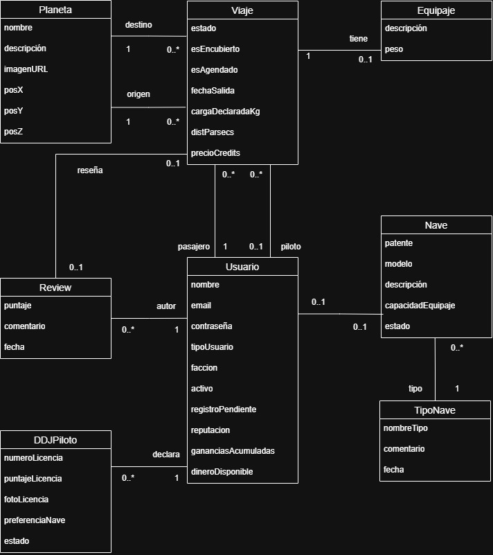

# Propuesta TP DSW

## Grupo
### Integrantes
* 52963 - Martinelli, Juan Bautista
* 52175 - Bruno, Julian
* 50949 - Gallucci, Juan Augusto
* 53168 - Gonzalez, Nahuan Ismael

### Repositorios
* [fullstack app](https://github.com/Juanchi45/FlySoloUltimate.git)

## Tema
### Descripción
*Sistema de solicitudes de viajes estilo Uber, con posibilidad de inscribirse como pasajero o piloto, junto con funcionalidades como indicar el pricipio y fin de viaje y reseñas hacia los pilotos.*

### Modelo

*Nota*: incluir un link con la imagen de un modelo, puede ser modelo de dominio, diagrama de clases, DER. Si lo prefieren pueden utilizar diagramas con [Mermaid](https://mermaid.js.org) en lugar de imágenes.

## Alcance Funcional 

### Alcance Mínimo

*Nota*: el siguiente es un ejemplo para un grupo de 3 integrantes para un sistema de hotel. El 

Regularidad:
|Req|Detalle|
|:-|:-|
|CRUD simple|1. CRUD Usuario 2. CRUD tipoNave 3. CRUD Planeta 4. CRUD Equipaje|
|CRUD dependiente|1. CRUD Nave {depende de} CRUD tipoNave 2. CRUD Review {depende de} CRUD Usuario 3. CRUD ddjjPiloto {depende de} CRUD Usuario 4. CRUD Viaje {depende de} CRUD Usuario/CRUD Planeta|
|Listado + detalle| 1. Listado de Planetas con filtro parcial por descripción => Detalle por (nombre, descripcion, imagen y coordenadas).  2. Listado de Viajes con filtro por estado => Detalle por (pasajero, piloto, ruta, distancia, precio, carga, fecha y reseña).|
|CUU/Epic|1. Solicitar un viaje. 2. Realizar review del piloto una vez finalizado el viaje.|

